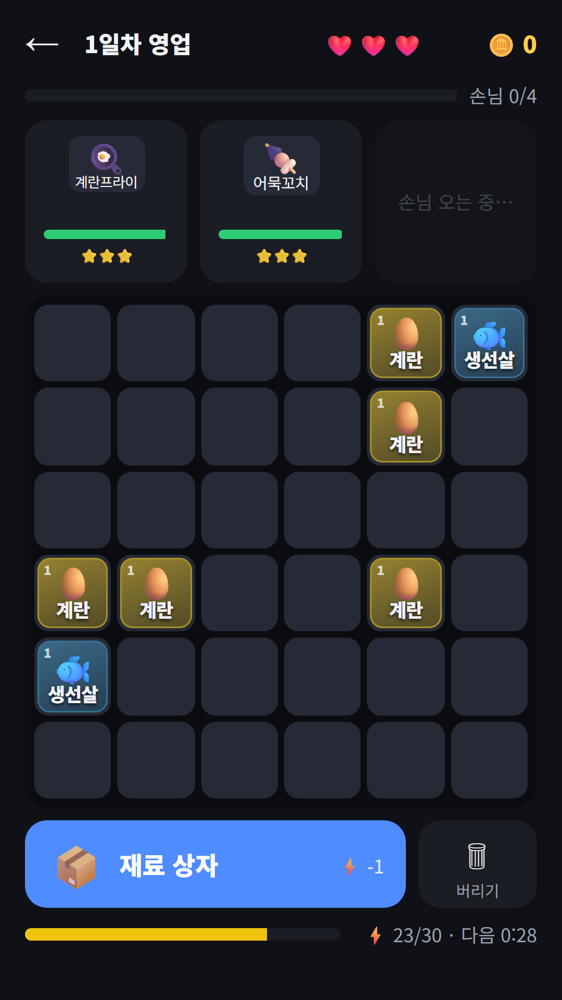
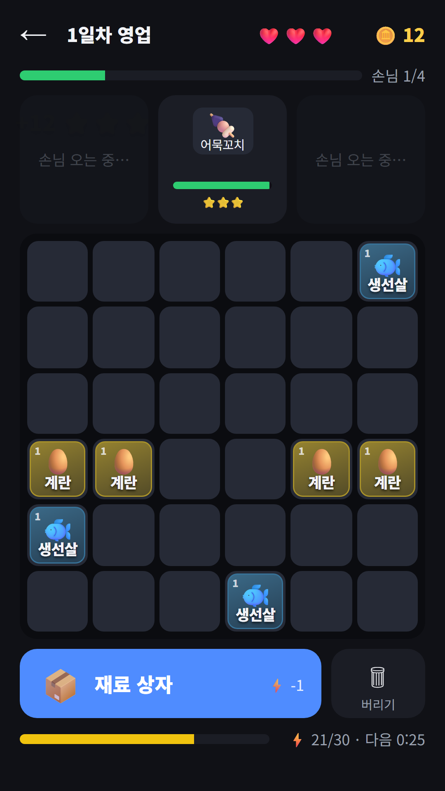
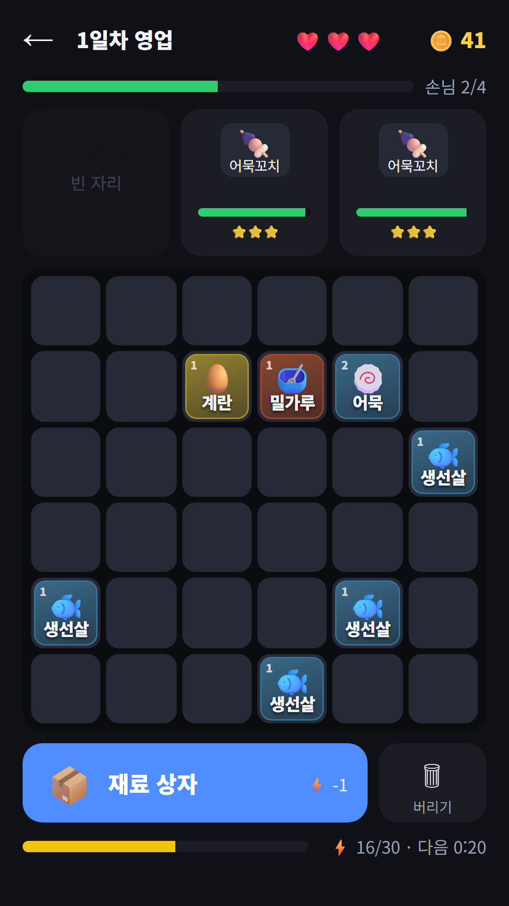
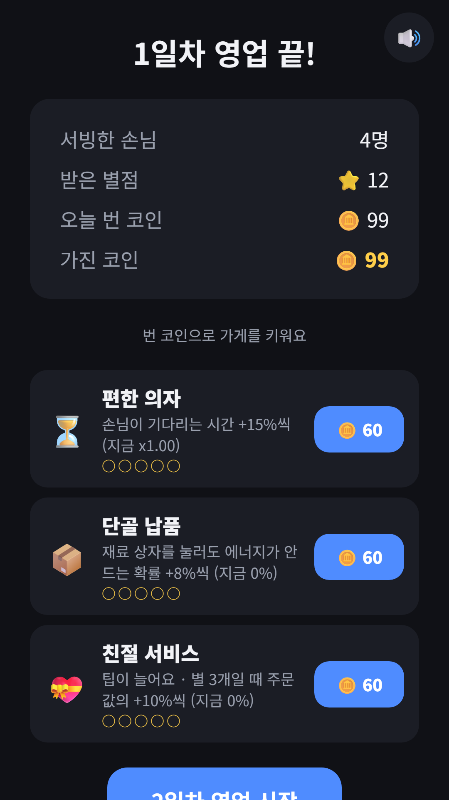

## Info
> **분식집 머지** — 분식집을 운영하며 재료를 합쳐 요리를 만들고 손님에게 서빙해 8일 영업을 완주하는 머지 게임이에요. Google Play에서 무료, 광고 포함.
{: .prompt-info }

## 이런 게임입니다
6x6 판 위에서 같은 재료 둘을 합쳐 단계별 분식 메뉴를 완성하고, 가게 앞에 줄 선 손님의 주문에 맞춰 서빙하는 캐주얼 머지·경영 게임입니다.

## 어떻게 하나요
- 재료 상자를 탭하고 6x6 판에서 같은 재료 둘을 합쳐요(쌀, 밀가루, 계란, 생선살 4가지 계열)
- 완성한 요리를 주문한 손님에게 끌어다 주세요. 인내심이 많이 남을수록 별과 팁이 늘어요
- 에너지는 시간이 지나면 차오르고, 손님이 너무 오래 기다리면 떠나며 하트 3개를 모두 잃으면 폐업해요
- 하루 영업이 끝나면 모은 코인으로 가게를 키워 다음 날을 준비해요

## 특징
- 매일 도전하는 오늘의 영업과 기록 TOP 10을 지원해요
- 원할 때만 보는 보상형 광고로 에너지를 더 받을 수 있어요
- 9개 언어로 즐길 수 있으며 회원가입이 필요 없어요

무료로 즐길 수 있으며 광고가 포함되어 있습니다(배너 광고와 원할 때만 보는 보상형 광고).

{: w="360" }
{: w="360" }
{: w="360" }
{: w="360" }

## Download
- Google Play: <https://play.google.com/store/apps/details?id=com.fadongkwon.merge_diner>

{: w="200" .normal }

소식은 이 블로그와 [인스타그램(@fadongkwon.soft)](https://www.instagram.com/fadongkwon.soft/)에서 전해드립니다.
