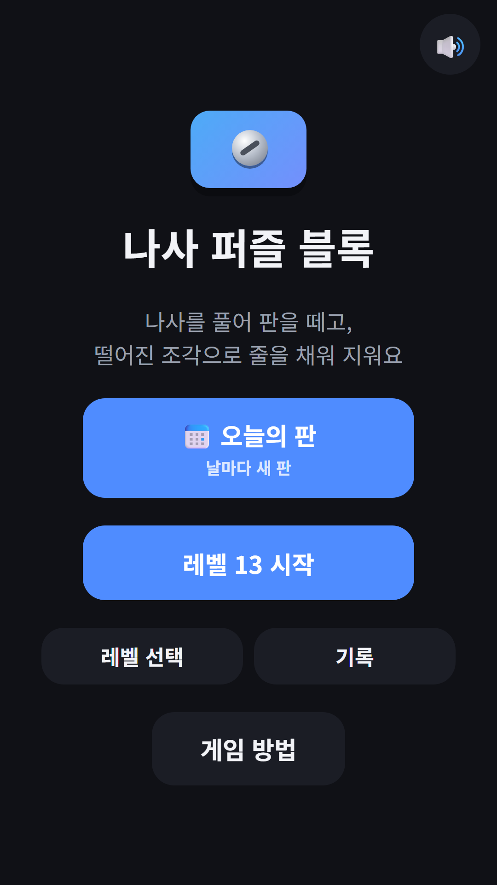
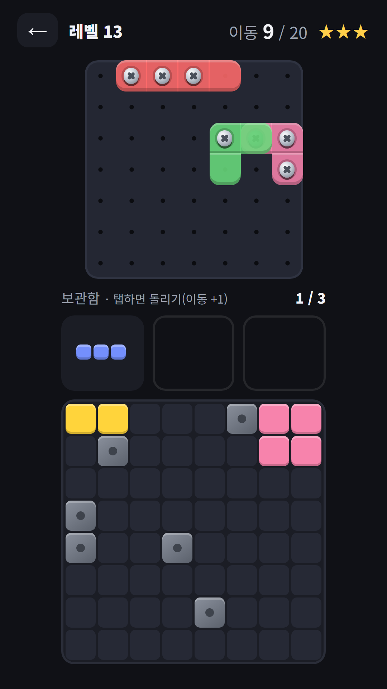
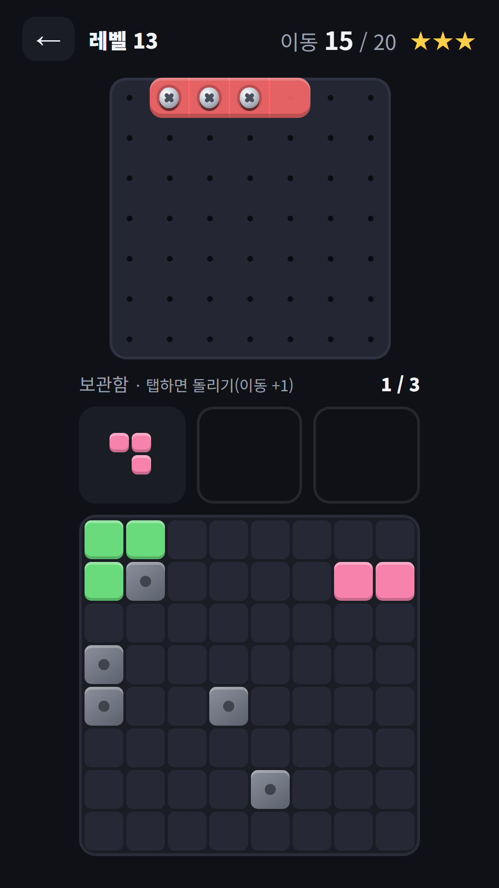
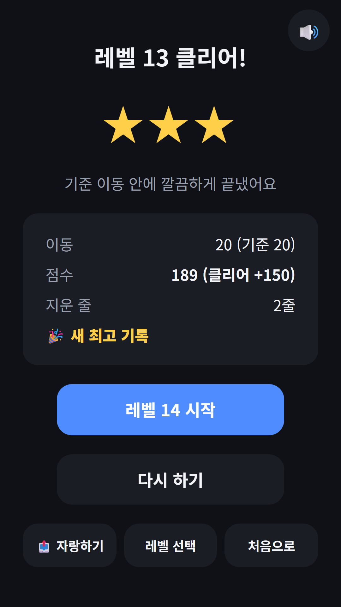

## Info
> **나사 퍼즐 블록** — 겹쳐 있는 판의 나사를 모두 빼고, 떨어진 조각을 8x8 칸에 배치해 가로·세로 줄을 채워 지우는 퍼즐 게임이에요. Google Play에서 무료, 광고 포함.
{: .prompt-info }

## 이런 게임입니다
나사 풀기 퍼즐과 8x8 블록 채우기 퍼즐을 한 판에 합쳤습니다. 위쪽 보드에서 나사를 덮고 있는 판부터 순서대로 떼어 내면 조각이 아래 3칸짜리 보관함으로 떨어지고, 그 조각을 8x8 칸으로 끌어다 놓아 줄을 지웁니다.

## 어떻게 하나요
- 판의 나사를 모두 빼면 3칸짜리 보관함으로 떨어져요. 나사를 덮고 있는 판을 먼저 떼어야 해요
- 조각을 8x8 칸으로 끌어다 놓고, 조각을 탭하면 회전할 수 있어요
- 가로 또는 세로 한 줄이 꽉 차면 지워지고 점수가 쌓여요
- 레벨 60개(별 최대 3개)와 매일 바뀌는 오늘의 판이 있어요. 뒤쪽 레벨에는 쇠블록이 등장해요

## 특징
- 원할 때만 보는 보상형 광고로 힌트를 보거나, 조각이 들어갈 곳이 없을 때 도움을 받을 수 있어요(각각 판마다 한 번)
- 9개 언어(한국어·영어·일본어·중국어·스페인어·포르투갈어·독일어·프랑스어·이탈리아어)를 지원해요
- 회원가입 없이 바로 즐길 수 있어요

무료로 즐길 수 있으며 광고가 포함되어 있습니다(배너 광고와 원할 때만 보는 보상형 광고).

{: w="360" }
{: w="360" }
{: w="360" }
{: w="360" }

## Download
- Google Play: <https://play.google.com/store/apps/details?id=com.fadongkwon.screw_fill>

{: w="200" .normal }

소식은 이 블로그와 [인스타그램(@fadongkwon.soft)](https://www.instagram.com/fadongkwon.soft/)에서 전해드립니다.
