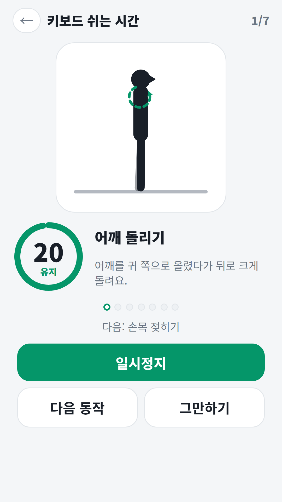
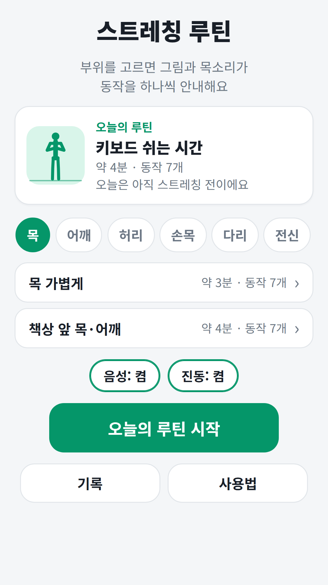
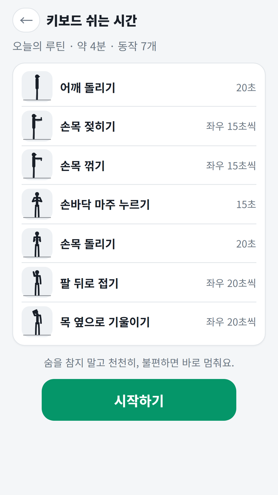
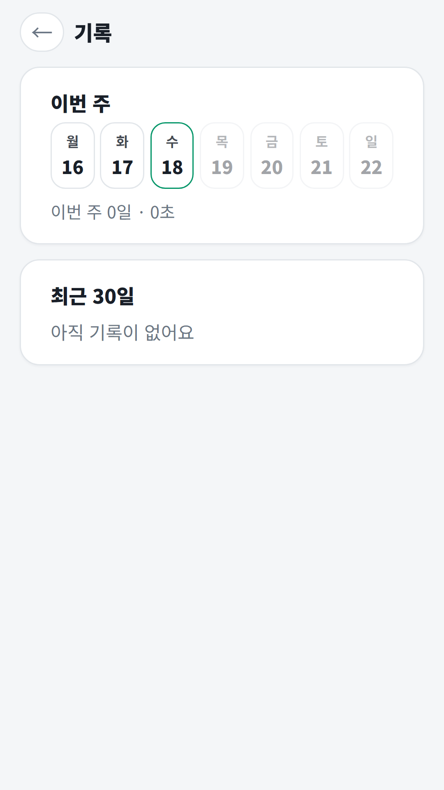

## Info
> **스트레칭 루틴 · Stretch Routine** — 목·어깨·허리·손목·다리·전신 6개 부위의 3~5분 루틴을 동작 그림과 음성 안내로 따라 하는 앱이에요. Google Play에서 무료, 광고 포함(배너·보상형).
{: .prompt-info }

## 이런 앱입니다
부위를 고르면 3~5분 스트레칭 루틴을 동작 그림과 남은 초 링, 음성 안내로 따라 할 수 있는 생활 도구예요. 목, 어깨, 허리, 손목, 다리, 전신 6개 부위의 14개 루틴(동작 28개)과 매일 바뀌는 오늘의 루틴을 담았어요.

준비 시간부터 동작 이름, 좌우 전환('반대쪽이에요'), 마지막 3·2·1초까지 목소리로 알려 줘서 화면을 계속 보지 않아도 흐름을 놓치지 않아요.

## 어떻게 쓰나요
- **오늘의 루틴**: 매일 바뀌는 3~5분 루틴을 홈에서 바로 시작할 수 있어요
- **부위별 루틴 14종**: 목·어깨·허리·손목·다리·전신 6개 부위에서 원하는 루틴을 골라 미리 동작을 확인하고 시작해요
- **동작 그림과 음성 안내**: 방향 화살표가 표시된 동작 그림, 한 줄 요령, 남은 초 링과 함께 한국어·영어 음성과 진동(선택)으로 안내해요
- **유연한 진행**: 일시정지, 다음 동작 건너뛰기, 그만하기를 지원하고 진행 중 화면이 꺼지지 않아요
- **기록**: 이번 주 7칸 기록, 연속일, 최근 30일 기록을 기기 안에만 저장해요

## 특징
- 회원가입 없이 무료로 바로 쓸 수 있어요
- 한국어와 영어 화면·음성 안내를 지원해요
- 의료기기가 아니며 질병의 진단·치료를 위한 것이 아니에요. 움직이는 중 불편하면 바로 멈추세요

광고가 포함되어 있습니다(배너·보상형). 오늘의 루틴은 광고 없이 바로 시작할 수 있어요.

{: w="360" }
{: w="360" }
{: w="360" }
{: w="360" }

## Download
- Google Play: <https://play.google.com/store/apps/details?id=com.fadongkwon.stretch_routine>

{: w="200" .normal }

## 함께 보면 좋은 앱
- [파동권 건강생활](/ko/posts/hub-health/) — 홈트 카운터·스트레칭 루틴·칼로리 사전을 한 앱에 모은 허브
- [홈트 카운터](/ko/posts/exercise-count/) — 횟수·세트·휴식을 목소리로 세어 주는 홈트 도구

소식은 이 블로그와 [인스타그램(@fadongkwon.soft)](https://www.instagram.com/fadongkwon.soft/)에서 전해드립니다.
