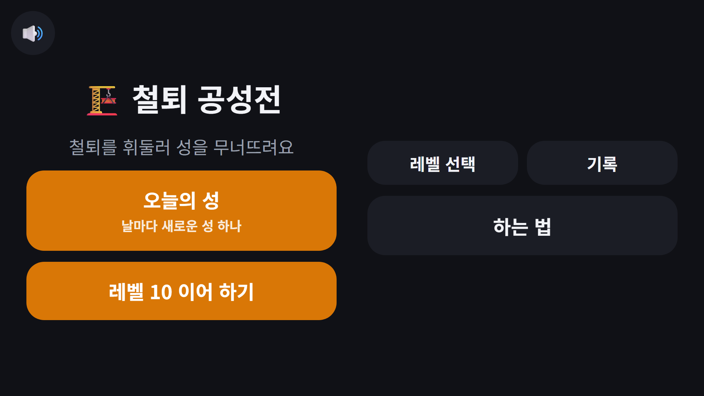
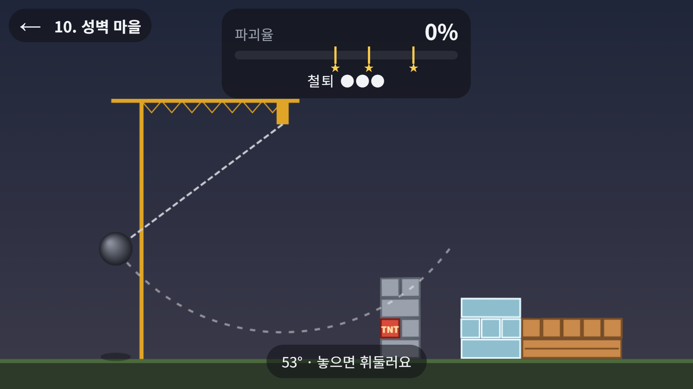
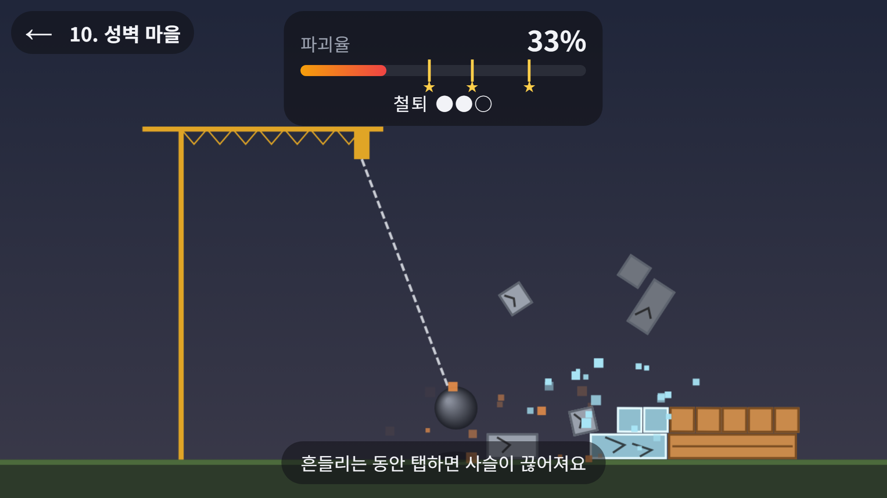
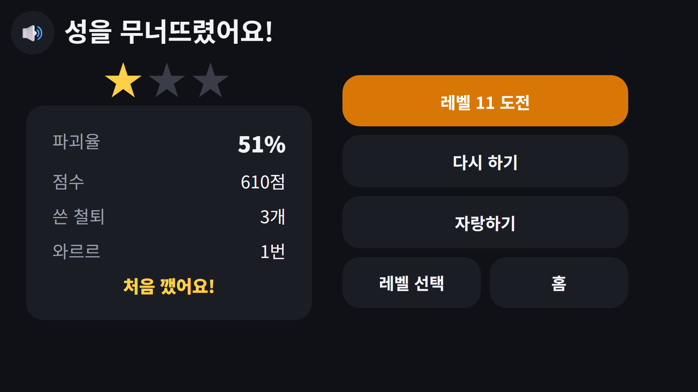
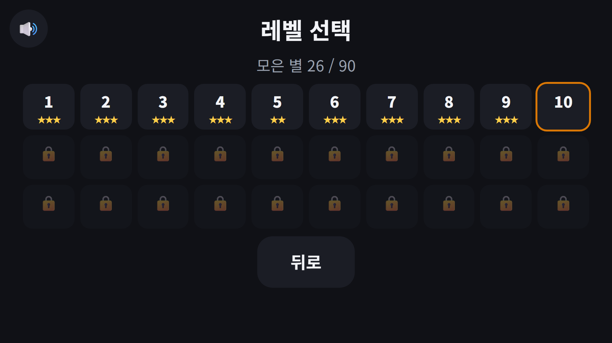
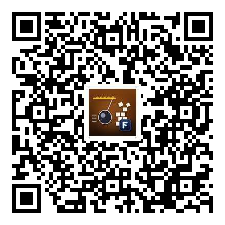

## Info
> **철퇴 공성전** — 크레인에 매달린 철퇴를 진자처럼 휘두르거나 사슬을 끊어 던져 성을 무너뜨리는 가로 화면 물리 게임이에요. Google Play에서 무료, 광고 포함(배너 없음).
{: .prompt-info }

## 이런 게임입니다
철퇴의 무게감과 사슬을 끊는 타이밍이 핵심인 가로 화면 물리 파괴 게임입니다. 가까운 성벽은 진자 스윙으로 부수고, 멀리 있는 탑은 흔들리는 도중 탭해 철퇴를 포물선으로 날려 맞힙니다.

## 어떻게 하나요
- 화면을 누른 채 뒤로 끌었다 놓으면 철퇴가 진자처럼 성을 후려쳐요
- 흔들리는 동안 탭하면 사슬이 끊어져 철퇴가 날아가요. 멀리 있는 성은 던져서 맞혀요
- 목표는 파괴율이에요. 부서지거나 무너진 블록이 성 전체에서 차지하는 비율로 별을 받아요
- 나무·돌·유리·TNT 블록이 저마다 다르게 부서지고, 회색 바위는 부서지지 않아요

## 특징
- 레벨 30개와 날마다 바뀌는 '오늘의 성'을 지원해요
- [파동권 공성전](/ko/posts/hub-siege/) 허브에서도 함께 즐길 수 있어요
- 9개 언어로 즐길 수 있으며 화면을 가리는 하단 배너 광고가 없어요

무료로 즐길 수 있으며 광고가 포함되어 있습니다(원할 때만 보는 보상형 광고 포함).

{: w="560" }
{: w="560" }
{: w="560" }
{: w="560" }
{: w="560" }

## Download
- Google Play: <https://play.google.com/store/apps/details?id=com.fadongkwon.wrecking_siege>

{: w="200" .normal }

소식은 이 블로그와 [인스타그램(@fadongkwon.soft)](https://www.instagram.com/fadongkwon.soft/)에서 전해드립니다.
