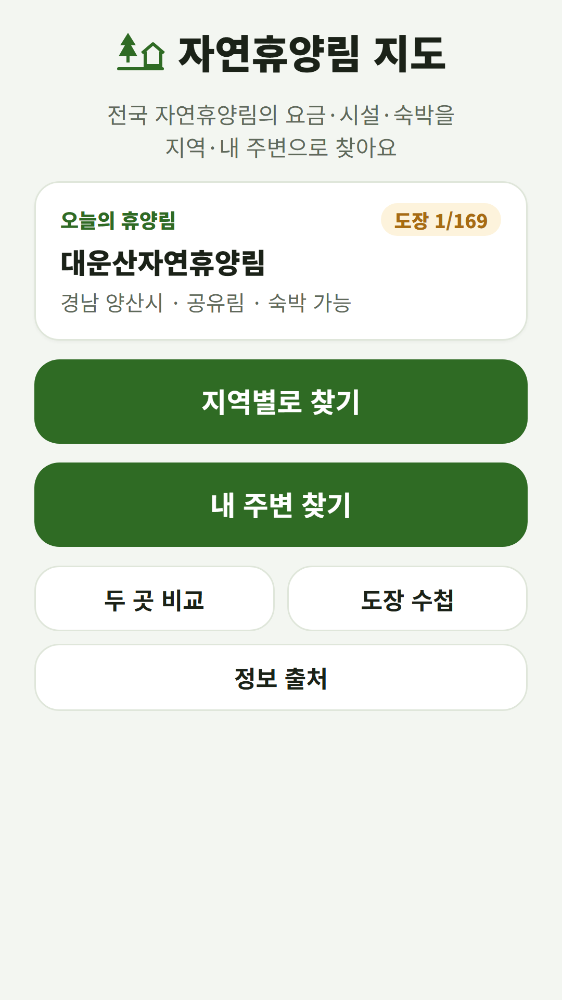
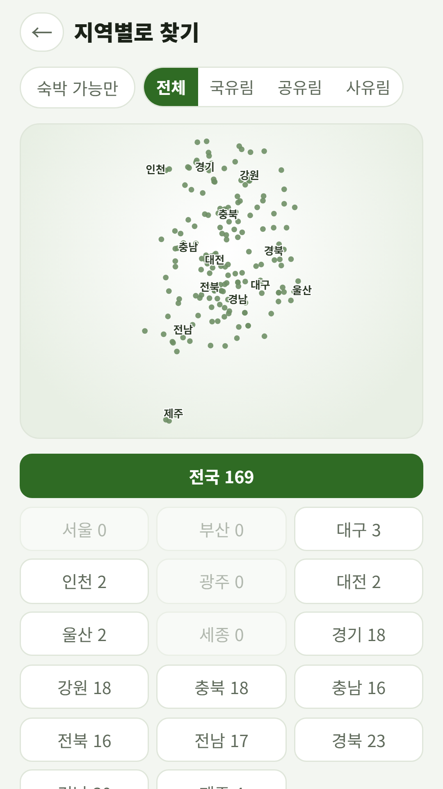
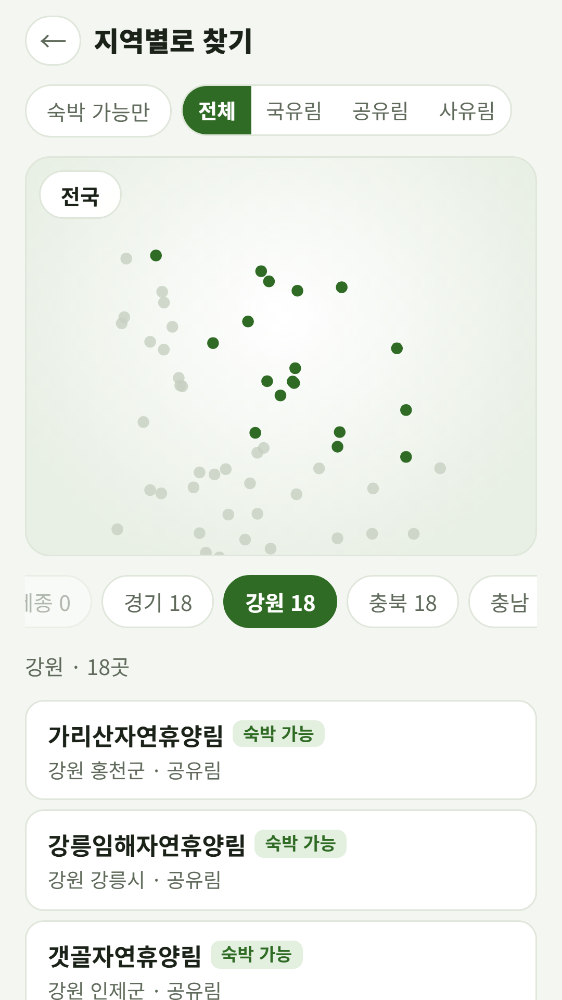
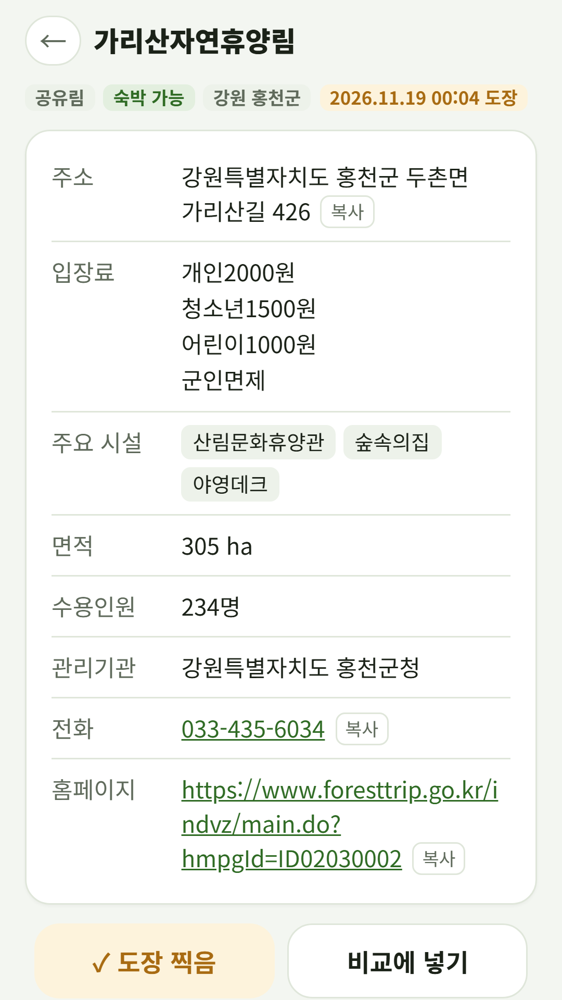
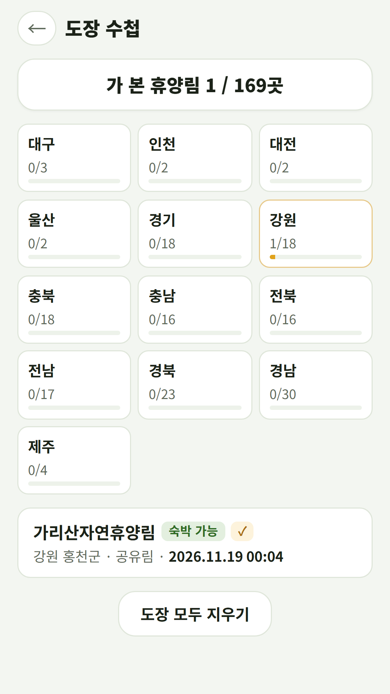

## Info
> **자연휴양림 지도 · Korea Forest Map** — 전국 169곳 자연휴양림을 지역별·내 주변에서 찾아 입장료·숙박 여부·시설을 확인하고, 두 곳을 비교하며 다녀온 곳에 도장을 찍는 앱이에요. Google Play에서 무료, 광고 포함(배너·보상형).
{: .prompt-info }

## 이런 앱입니다
공공데이터포털의 「전국휴양림표준데이터」(데이터 ID `15013111`)에서 전국 169곳(숙박 가능 156곳) 자연휴양림 정보를 담았어요. 데이터가 앱 안에 들어 있어 첫 화면이 바로 뜨고, 외부 지도 서비스 없이 휴양림 위치를 점으로 찍어 시·도별로 좁혀 볼 수 있어요.

## 어떻게 쓰나요
- **지역별로 찾기**: 점 지도에서 시·도를 고르고 '숙박 가능만' 또는 구분별 필터로 좁혀 볼 수 있어요
- **내 주변 찾기**: 버튼을 누를 때만 대략적 위치를 묻고 가까운 휴양림을 거리순으로 보여 줘요. 위치는 기기 안에서 거리 계산에만 쓰고 저장하거나 보내지 않아요
- **상세 정보**: 구분, 숙박 여부, 주소, 입장료, 주요 시설, 면적, 수용인원, 연락처
- **두 곳 비교**: 두 휴양림을 나란히 놓고 요금·시설·직선 거리를 한눈에 비교해요
- **도장 수첩 · 오늘의 휴양림**: 다녀온 곳에 방문 도장을 찍어 모아 보고, 날짜마다 추천 휴양림 한 곳을 만나요

## 특징
- 회원가입 없이 무료로 바로 쓸 수 있고, 방문 기록은 기기 안에만 저장돼요
- 화면 문구와 휴양림 이름은 한국어 전용이에요
- 이 앱은 어떠한 정부 기관이나 공공기관도 대표하지 않는 민간 개발자(Fadongkwon Soft)의 독립 앱이며, 예약 기능은 제공하지 않아요. 데이터 기준일은 휴양림마다 달라 방문 전 운영 여부를 확인해 주세요

광고가 포함되어 있습니다(배너·보상형). 검색·상세 보기·방문 도장은 광고 없이 바로 쓸 수 있어요.

{: w="360" }
{: w="360" }
{: w="360" }
{: w="360" }
{: w="360" }

## 플레이 영상


## Download
- Google Play: <https://play.google.com/store/apps/details?id=com.fadongkwon.forest_map>

{: w="200" .normal }

## 자료 출처
공공데이터포털(data.go.kr) 「전국휴양림표준데이터」(데이터 ID 15013111, 2026년 11월 내려받음).

## 함께 보면 좋은 앱
- [박물관 지도](/ko/posts/museum-map/) — 전국 1,024곳 박물관·미술관을 지역별·내 주변으로 찾는 앱
- [파동권 주말생활](/ko/posts/hub-weekend/) — 여행 시기·박물관·홈트 생활 도구를 한 앱에 모은 허브

소식은 이 블로그와 [인스타그램(@fadongkwon.soft)](https://www.instagram.com/fadongkwon.soft/)에서 전해드립니다.
