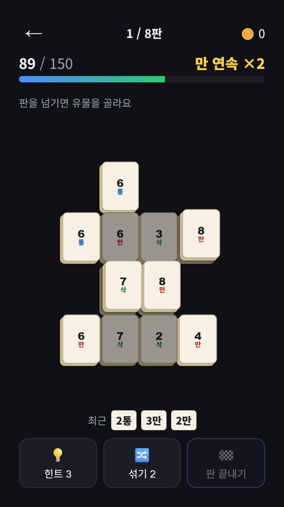
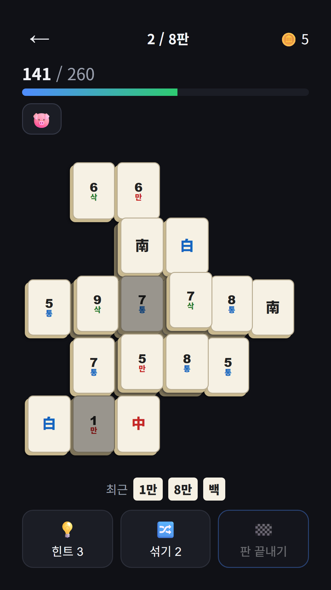

## Info
> **마작 원정 · Mahjong Quest** — 마작 솔리테어에 로그라이크를 더한 퍼즐 게임이에요. Google Play에서 무료, 광고 포함(배너·보상형). 토스에서는 [파동권 퍼즐카페](/ko/posts/hub-puzzle/) 안에서 즐길 수 있어요.
{: .prompt-info }

## 이런 게임입니다
마작 솔리테어로 한 판을 풀고, 로그라이크처럼 판을 넘어 가며 유물을 쌓는 게임이에요. 위가 덮이지 않고 왼쪽이나 오른쪽이 트인 패만 고를 수 있고, 같은 패 두 장을 탭하면 사라져요. 판마다 목표 점수가 있어서 그 점수를 넘겨야 다음 판으로 가요. 판이 끝나면 유물 3개 중 1개를 골라 점수 계산에 효과를 더하고, 이렇게 8판을 모두 넘으면 원정 성공이에요.

## 어떻게 하나요
- 위에 아무것도 없고 왼쪽이나 오른쪽이 열린 패 두 장이 같으면 탭해서 걷어 내요
- 점수는 칩 × 배수예요. 칩은 숫자패가 숫자+2, 바람 10, 삼원 12예요
- 같은 무늬(만·통·삭·바람·삼원)를 이어서 맞히면 배수가 1, 2, 3으로 올라가요(최대 5)
- 최근 세 짝이 같은 무늬의 이어진 숫자(예: 3·4·5만)면 순서 보너스 30칩이 붙어요
- 목표 점수를 넘기면 통과, 패를 다 비우면 보너스가 더 붙어요
- 막히면 섞기를 써요(판마다 2번). 힌트는 판마다 3번 무료예요

## 특징
- 8판 구성: 첫 판은 6×4 두 층, 마지막 판은 8×6 네 층까지 점점 커지고 목표 점수도 올라가요
- 유물 18종: 만·통·삭 수집가, 바람길, 용의 비늘, 기세, 순서 장인, 저금통 같은 효과를 원정이 끝날 때까지 쌓아요
- 판을 넘길 때 받는 코인으로 유물 다시 뽑기(2코인)나 섞기 구매(3코인)를 할 수 있어요
- 새 판은 항상 끝까지 풀 수 있게 배치돼요(섞은 뒤에는 보장하지 않아요)
- 오늘의 원정: 같은 날에는 누구나 같은 판으로 겨뤄요
- 하던 원정 이어하기, 기록 TOP 10과 원정 횟수·성공 횟수·최고 도달 판·오늘의 원정 연속 기록
- 9개 언어, 회원가입 없이 바로 할 수 있어요

원할 때만 보는 보상형 광고로 힌트나 섞기를 더 받을 수 있고, 화면 아래에 배너 광고가 붙어요. 광고가 포함되어 있습니다(배너·보상형).

{: w="360" }
{: w="360" }
{: w="360" }
{: w="360" }

## 플레이 영상


## Download
- Google Play: <https://play.google.com/store/apps/details?id=com.fadongkwon.mahjong_rogue>
- 토스: [파동권 퍼즐카페](/ko/posts/hub-puzzle/) 안의 '마작 원정'

{: w="200" .normal }

## 함께 보면 좋은 앱
- [파동권 퍼즐카페](/ko/posts/hub-puzzle/) — 블록 탈출·마작 원정 등 머리를 쓰는 퍼즐 허브

소식은 이 블로그와 [인스타그램(@fadongkwon.soft)](https://www.instagram.com/fadongkwon.soft/)에서 전해드립니다.
